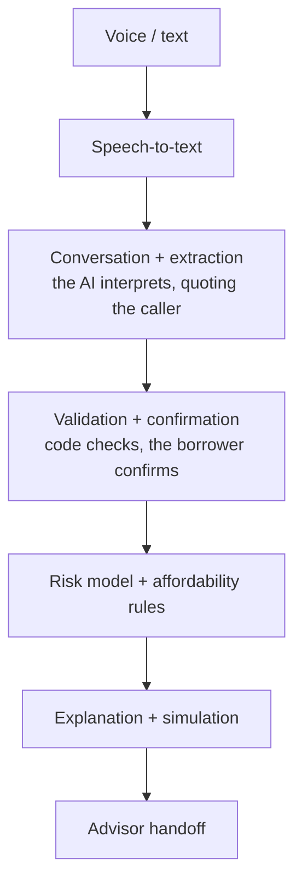
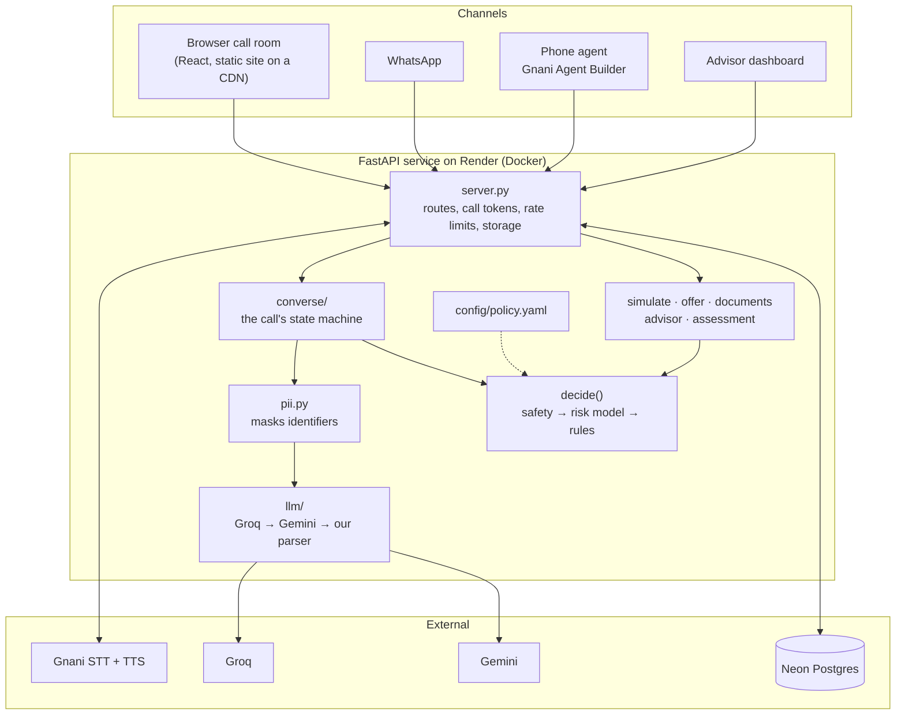
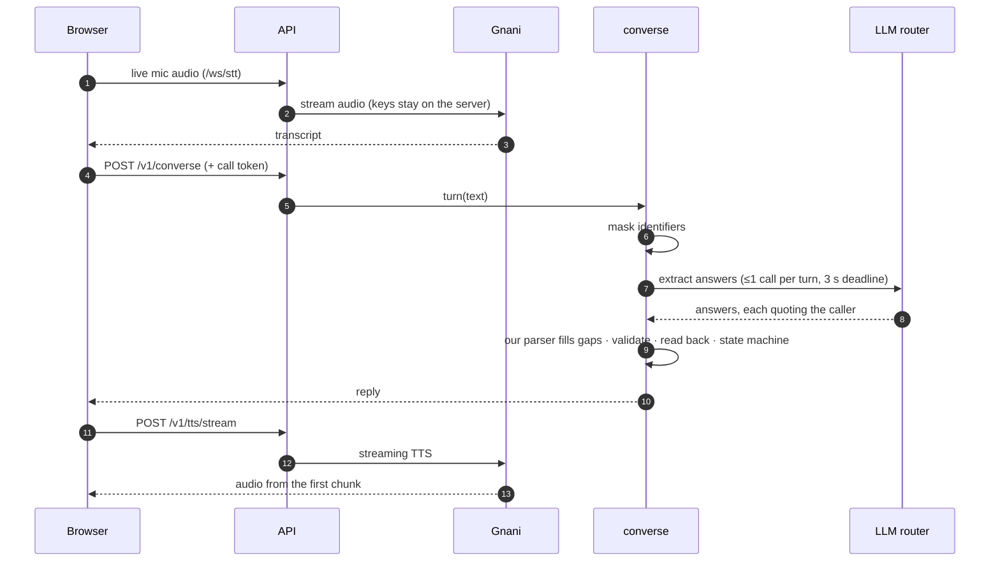

# Loan-Saathi

**Voice-first AI loan pre-screening for first-time borrowers in India**

*Speak naturally. Confirm what was understood. Understand what you can safely afford.*

Loan-Saathi turns a short Hindi, Hinglish or English conversation into a validated financial profile, an
estimated risk assessment, affordability guidance, an explanation of the result, and what-if loan simulations.

It is built for people taking their first loan, who may find it easier to *say* their situation than to fill in
a loan form. It is a **pre-screening** tool: it helps a borrower understand and prepare.

> **Loan-Saathi is not an autonomous loan approval system.** It never approves or rejects a loan.
>
> **AI interprets. Code validates. You confirm. Models estimate. Rules protect. Humans decide. Evidence proves.**

**[Live demo](https://loan-saathi.onrender.com)** · **[GitHub](https://github.com/KanishkaSingh19/Loan-Saathi)** ·
**[2-minute demo script](DEMO.md)**

The live demo runs on free hosting, so the first load can take up to a minute while the server wakes. No sign-in
is needed: press **Talk to Saathi** and speak, or type.

<!-- Add 20–30 second demo GIF/video here -->

---

## Why Loan-Saathi?

A first-time borrower may be far more comfortable saying:

> "Meri salary 40 hazaar hai aur mujhe 2 lakh ka loan chahiye."

than filling out a complicated loan form in English.

But a spoken conversation is easy to mishear. "Fourteen" and "forty" sound alike. "40" could mean ₹40 or
₹40,000. A wrong number, silently accepted, gives a wrong answer about someone's money.

Loan-Saathi is designed to turn that conversation into structured information **without silently
misunderstanding the numbers that matter**. It checks them, reads them back, and waits for the borrower to
confirm before it estimates anything.

## What the user experiences

**LISTEN → UNDERSTAND → VERIFY → ASSESS → EXPLAIN → SIMULATE → NEXT STEP**

1. **Listen.** The borrower speaks naturally in Hindi, Hinglish or English.
2. **Understand.** The system picks out things like income, existing EMIs, loan amount and tenure.
3. **Verify.** Important numbers are checked and read back to the borrower before any assessment.
4. **Assess.** Affordability rules and a risk model estimate how much repayment pressure the loan would create.
5. **Explain.** The borrower sees what was understood, the estimated result, and why.
6. **Simulate.** They can ask "What if I take a smaller loan?" or change the tenure.
7. **Next step.** They get a list of documents to keep ready, or a structured summary for a loan advisor.

They can also ask a question at any point ("EMI kya hota hai?") and get an answer in the language they asked
in, or check a loan offer they already received.

## Why this is different from a normal LLM chatbot

| Typical LLM chatbot | Loan-Saathi |
|---|---|
| Generates an answer | Extracts structured financial information |
| Can guess missing information | Missing or ambiguous values are checked with the borrower |
| May silently change numbers | Important values are validated, read back and confirmed |
| The LLM drives the conversation freely | A fixed workflow controls every step |
| The model can produce the final response | Code controls all financial calculations and outcomes |
| Difficult to audit | The decision path and the source of every number are recorded |
| One-shot answer | Assessment + explanation + simulation |

Loan-Saathi is a controlled AI system. The language model is one part of it, and the least trusted one.

## The LLM does not decide the loan outcome

```
Caller → AI interpretation → Validation → User confirmation → Risk model + rules → Explanation
```

- **The LLM interprets** what the borrower says. It must quote the caller's own words for every value, or the
  value is thrown away.
- **Code validates** each value: ranges, ambiguity, contradictions.
- **The borrower confirms** the profile. Nothing is assessed before that.
- **The risk model estimates** risk. It does not approve anything.
- **Affordability and debt rules** constrain the result, whatever the model says.
- **The system never claims a borrower is approved.** The best outcome is "eligible for further review".
  A loan advisor or lender decides.

## We deliberately tried to break the model

During testing we found this:

> A borrower with **₹36.5 lakh of existing debt** and ₹40,000 monthly income was given a **lower** predicted
> risk (6.1%) than the same borrower with **no debt** (8.2%).

The model was not broken in the usual sense. In its training data, large debts mostly belonged to wealthier
borrowers, so it had learned "more debt, safer". That is statistically valid and financially wrong.

So we measured how often it happens, then fixed it:

| Step | Result |
|---|---|
| Built 240 synthetic borrower profiles and raised each one's debt step by step | 1,680 checks |
| Original model: risk *fell* as debt rose | **520 of 1,680** checks failed |
| Added a hard rule: owing more than 24 months of income means "not right now" | applies whatever the model says |
| Retrained so more debt can never lower the predicted risk | **0 of 1,680** checks fail |

**The lesson:** a model can produce a mathematically valid prediction that still behaves incorrectly in the real
world. We test whether its behaviour makes financial sense, not just whether its headline metric looks good.

## What we measured

Every figure comes from a file a script wrote. The dashboard's **Evaluation Lab** shows each one with its source.

| Test | Result | What it means |
|---|---|---|
| Held-out extraction | **51/54** | Understanding of spoken answers on an unseen set, written and frozen before the first run |
| Development extraction | 64/64 | After fixing the parser bugs this set found (first run: 59/64); **not** an independent figure |
| Voice first-audio latency | **2.17 s median / 3.36 s P90** | Caller stops speaking → reply audio starts; 13 scripted Hinglish turns on one machine |
| Debt monotonicity | **0/1,680 failures** | The final model and rules passed the synthetic debt checks (was 520/1,680) |
| LLM outage | 3.0 s, not 8.0 s | How long a turn waits before deterministic logic takes over (simulated outage) |
| Shorter call | same outcome for 215/215 | Skipping questions that can't change the result never changed a decision (synthetic applicants) |
| Safety suites | Tested | Confirmation, ambiguity, contradictions, failures, no approval claims, no LLM decisions |

Caveats, kept on purpose:

- The latency figure uses a synthetic caller voice on one machine. A real phone line will be slower.
- The extraction sets are hand-written by the developers, not real caller transcripts.
- "Synthetic" means generated test profiles, **not** real borrower outcomes.

### What we have NOT measured

- Accuracy on real Indian borrowers
- Outcomes with real first-time borrowers
- Real-world lending performance

No labelled Indian outcome data is available to us, so we do not claim any of these.

## Product screenshots

<!-- Add screenshots here: conversation · confirmation card · result · financial picture · what-if simulation · advisor view -->

No screenshots are in the repository yet. Until they are, the fastest way to see the product is the
**[live demo](https://loan-saathi.onrender.com)**, and [DEMO.md](DEMO.md) walks through each screen:

| Screen | What it shows |
|---|---|
| Conversation | A live call: you speak, Saathi answers when you pause, captions on screen |
| Confirmation | "Here's what I understood", with Confirm and Change |
| Result | A big status, one sentence, the EMI you can afford, two buttons |
| Financial picture | Monthly income split into existing EMIs, the new EMI and what is left |
| What-if simulation | Change the amount or tenure and compare with your request |
| Advisor view | The structured case a loan advisor receives |

## How the AI works



The conversation follows fixed stages. If an AI provider fails or is slow, the system falls back to its own
deterministic logic instead of stopping the call.

**Built with:** Gnani Prisma (speech-to-text) and Timbre (text-to-speech) · Groq and Gemini (language
models) · LightGBM (risk model) · FastAPI · React · PostgreSQL on Neon.

More detail, with diagrams: [docs/system-design.md](docs/system-design.md).

## Risk model

- **LightGBM estimates risk.** It was trained on the public
  [Home Credit Default Risk](https://www.kaggle.com/c/home-credit-default-risk) dataset, using only things a
  caller can say (28 inputs).
- **Measured honestly.** Validation AUC is **0.711**. A benchmark model with full credit-bureau data reaches
  0.789; the gap is the real cost of asking questions instead of pulling bureau records.
- **The bands separate people.** On held-out data, the low band defaulted 3.2% of the time, medium 8.0%, high
  18.8%.
- **Different approaches were tested.** LightGBM, XGBoost and CatBoost scored within 0.0013 AUC of each other
  on the voice model. Asking better questions (six about repayment history) added far more: AUC 0.687 → 0.711.
- **Constrained to behave sensibly.** More debt, a higher EMI burden or a history of late payments can never
  make a borrower look safer.
- **A real failure was found and corrected** (the debt story above).
- **Calibration was checked, not assumed.** A calibration step was tried and kept only if it improved held-out
  error. It did not, so the raw predictions are used.
- **No gender or marital status** is used. Age is used by the model but never given to a borrower as a reason.
- **The model does not make an approval decision**, and it does not choose loan amounts. Those come from the
  affordability rule.

## Explainability and safety

**Number provenance.** Every number shown is labelled with where it came from:
*You told us* · *Calculated by Loan-Saathi* · *Based on affordability rules* · *Estimated by model*.

**Confirmation.** No assessment happens before the borrower confirms the interpreted financial profile.

**Safety.** The system handles, and is tested on:

- ambiguous numbers ("40", "40-50 hazaar", "fourteen/forty")
- contradictory answers (asked about, never silently overwritten)
- invalid values (negative income, a 50-year tenure, an EMI above the income)
- excessive debt
- the risk model failing
- speech-to-text failing
- the language model failing or being slow

**Privacy.** Phone, Aadhaar, PAN and account numbers and names are masked before any text reaches a language
model. Answers are stored only with consent and deleted after 30 days.

**No approval claims.** Loan-Saathi provides an estimated pre-screening result, not a lender approval or
guarantee. An automated test scans everything a borrower can see or hear for approval wording and lender names.

## What-if simulation

A borrower can change the loan amount or the tenure and see how the estimated EMI, affordability, repayment
burden and risk band change.

- "What if I take ₹2 lakh?"
- "What if I choose 5 years?"
- "What is the maximum EMI I can afford?"

They can ask by voice or use sliders. Three ready options sit on top: a **safer option**, **your request**, and
a **higher burden** example.

The original request is always preserved. Every simulation runs through the same checks, model and rules as
the real assessment, and is labelled *Simulation — not a lender offer*.

EMIs are shown as a **range** (across 14–24% yearly interest), because the lender's real rate is not known yet.

## Limitations

- The risk model is trained on the **Home Credit Default Risk dataset, not a labelled Indian borrower dataset**.
- Borrower inputs are **self-reported** and unverified. There is no credit-bureau check.
- This is a **pre-screening tool**, not a final lending decision.
- **Real borrower outcomes have not been measured.** Every figure above is scripted or synthetic.
- A final lending decision needs identity checks, document verification and the lender's own process.
- The live demo runs on free hosting: it sleeps when idle, and the free AI tiers are rate-limited.

## Tech stack

| Layer | Technology |
|---|---|
| Voice | Gnani Prisma (speech-to-text), Gnani Timbre (text-to-speech), Gnani Agent Builder (phone agent) |
| LLM | Groq, with Gemini as fallback |
| ML | LightGBM |
| Backend | FastAPI, Python |
| Frontend | React, Vite |
| Database | PostgreSQL on Neon (SQLite locally) |
| Deployment | Render (Docker web service + static site) |
| Testing | pytest, Ruff, GitHub Actions |

## Project structure

```
agent/       phone-agent prompt and Agent Builder setup
src/         the API, the conversation, the risk scoring and the rules
models/      the trained models and their validation reports
dashboard/   the React app: borrower call room and advisor views
tests/       unit tests and end-to-end suites
docs/        system design and design decisions
config/      the lending rules, in one file (policy.yaml)
reports/     benchmark results the README quotes
deploy/      deployment guide
```

## Running locally

You need Python 3.10+ and Node.js 20.19+. The trained models are included.

```bash
git clone https://github.com/KanishkaSingh19/Loan-Saathi.git
cd Loan-Saathi
```

**One command** (creates a virtualenv, installs, builds the dashboard, makes a local key, starts the server):

```bash
./demo.sh
```

On Windows PowerShell, run `.\demo.ps1` instead. Then open http://127.0.0.1:8000/dashboard/.

**Without API keys: typing mode.** Everything works by typing: the conversation, confirmation, assessment,
simulation and advisor case. The built-in parser understands Hindi, Hinglish and English without any LLM.

**With Gnani keys: the voice experience.** Add `GNANI_STT_API_KEY` and `GNANI_TTS_API_KEY` (or one shared
`GNANI_API_KEY`) to `.env`. Optionally add `GROQ_API_KEY` and `GEMINI_API_KEY` for LLM understanding. Keep
`.env` private and never commit it.

**Run the tests:**

```bash
python -m pytest
python -m ruff check src tests
cd dashboard && npm test && npm run lint && npm run typecheck && npm run build
```

<details>
<summary>Manual setup (PowerShell), retraining and the phone agent</summary>

```powershell
py -m venv .venv
.\.venv\Scripts\Activate.ps1
Copy-Item .env.example .env
pip install -r requirements.txt
python -I -X utf8 src/server.py
```

Set `WEBHOOK_KEY` in `.env` to a long random value; the server refuses to start without one. The API is at
`http://127.0.0.1:8000`, with interactive docs at `/docs`.

**Retraining** needs the [Home Credit CSVs](https://www.kaggle.com/c/home-credit-default-risk/data) in
`data/kaggle/` (or set `HOME_CREDIT_DATA_DIR`):

```powershell
python -I -X utf8 src/train.py               # both models
python -I -X utf8 src/train.py --voice-only  # the voice model only
python -I -X utf8 src/validate_model.py --strict   # behaviour checks; run after every retrain
```

**Phone agent.** Gnani's servers must reach the webhook, so expose port 8000 with a tunnel
(`cloudflared tunnel --url http://localhost:8000`) and follow [agent/SETUP.md](agent/SETUP.md).

**Deployment.** See [deploy/DEPLOY.md](deploy/DEPLOY.md).

</details>

---

## Technical details

The sections below are for readers who want the engineering depth. Each opens on click.
The full map is in [docs/system-design.md](docs/system-design.md); the reasoning is in
[docs/decisions.md](docs/decisions.md).

<details>
<summary><b>Architecture and one call turn</b></summary>





The API routes, storage tables and deployment are listed in [docs/system-design.md](docs/system-design.md).

</details>

<details>
<summary><b>The conversation: state machine, extraction, recovery</b></summary>

- **Fixed stages, not a free chat.** The call moves through states (collecting → verifying → confirmed →
  assessing risk → checking affordability → result → next steps), plus correction, error recovery and advisor
  handoff. Any move not in the allowed list raises an error (`src/converse/states.py`).
- **Quote-gated extraction.** The model must quote the caller's exact words before an answer is accepted.
  Answers it can't quote are dropped, so it can't invent an age or a house.
- **A deterministic parser underneath.** Our own Hindi/English parser reads amounts ("dhai lakh", "ढाई लाख",
  "1 lakh 50 hazaar"), tenures, counts and yes/no. It fills what the LLM misses and runs the whole call when no
  LLM is available.
- **One message, many answers.** "kirana dukaan 6 saal se, ek bike loan hai 3000 EMI" fills four fields.
- **Risky numbers are read back**: a bare "40", a range, two amounts in one answer, "-teen/-ty" words, very
  large values. A value that contradicts an earlier one is asked about, never overwritten.
- **Corrections without restarting.** "My income is wrong" changes only the income, then reads the profile back.
- **Recovery.** After one unclear answer Saathi repeats the question with its options (and tap buttons). After
  two, an optional question can be skipped; a required one offers a retry or an advisor.
- **A shorter call.** Rule questions come first. A question only the risk model reads is asked only while some
  answer could still change the risk band. Mean turns 14.43 → 13.04 with identical outcomes
  (`reports/call_length.json`).
- **Questions mid-call** are answered from fixed, tested text in the caller's language
  (`src/converse/faq.py`), then the call continues. A question never counts as a failed answer.
- **Language.** Our code, not the LLM, picks the reply language from the caller's words. The caller can also
  say "English please" or use the switch.
- **Loan purpose.** Saathi asks what the loan is for and uses it only for a tenure hint and the document
  checklist; it is never a model or rule input (`tests/test_loan_purpose.py`).

</details>

<details>
<summary><b>LLM fallback, PII masking and reliability</b></summary>

- **Provider order.** Groq first, then a second Groq model, then Gemini, then our parser, under one 3-second
  deadline per use, with one retry on invalid JSON and a small response cache (`src/llm/`).
- **At most one LLM call per turn**, so a turn never waits twice. Each call records which provider answered.
- **Result wording is checked.** An LLM-phrased result is used only if every number matches the decision and the
  EMI is given as its range; otherwise a scripted line is used.
- **PII masking** (`src/pii.py`): phone, Aadhaar, PAN, IFSC, account and card numbers, email, date of birth,
  PIN code and names are masked before any LLM call and before our own parser reads the text.
- **Sessions survive restarts.** Every turn is saved and a call can resume for 2 hours.
- **Cold starts.** The dashboard is also a static site on a CDN; it loads at once and wakes the API.
- **Failures are clean.** A speech-to-text failure asks the caller to try again; a model failure pauses with a
  retry; nothing is ever made up.

</details>

<details>
<summary><b>Rules, policy configuration and the decision</b></summary>

- **`config/policy.yaml`** holds every lending rule: all EMIs within 50% of income, the comfortable 40% level,
  the 24-month debt limit, the assumed 18% interest, the EMI range (14–24%), accepted tenure and age ranges,
  amount limits and retention. The server refuses to start if a value is missing or out of range.
- **`decide()`** runs a safety check, then the risk model, then the rules. The simulator, the offer check and
  the advisor case all go through it, so nothing bypasses a rule.
- **Outcomes:** eligible for further review · a smaller loan that fits · not right now (with what would change
  it) · more information needed.
- **Risk bands** (low under 5%, medium under 12%, high above) are stored with the trained model, so they always
  match it.

</details>

<details>
<summary><b>Model details: features, constraints, calibration, comparison</b></summary>

**Better questions, not a bigger algorithm.** Six short repayment-history questions were each measured on the
same split (`src/experiment_features.py`):

| Question | AUC gain alone |
|---|---|
| In the last 12 months, did you pay any EMI late? | +0.0086 |
| How many loans have you taken, closed ones included? | +0.0078 |
| Have you ever paid an EMI late? | +0.0043 |
| Has a loan application of yours ever been refused? | +0.0042 |
| Ever more than a month late? / Is an EMI overdue now? | about +0.001 each |
| **All six together** | **+0.0204** |

A first-time borrower hears only two of them. "Don't know" stays unknown and is never turned into "no". Every
"yes" can only raise risk (0 of 960 synthetic checks failed). A small hyperparameter search (12 settings) moved
AUC by at most 0.0014.

**Decisions made along the way**

- **Removed a misleading signal.** Loan size ÷ EMI looked predictive, but it mostly reflects the interest rate
  the original lender charged. A voice agent can't know that.
- **Explanations are what-if effects**: swap in a typical applicant's value and see the change. Only factors
  that are fair and meaningful are spoken.
- **Currency.** The dataset isn't in rupees; amounts are scaled so its median monthly income equals ₹25,000.
  Ratios are unaffected.
- **The debt constraint** cost 0.0025 AUC and left the risk bands unchanged.

**LightGBM vs XGBoost vs CatBoost** (same split, matched settings; `src/compare_models.py`)

Voice model, earlier version (22 features; not repeated for the current 28-feature model):

| Model | AUC | Brier | Train time | Score 1 caller | Model size |
|---|---|---|---|---|---|
| **LightGBM** | **0.6889** | 0.0712 | **14 s** | 7.3 ms | **1.1 MB** |
| XGBoost | 0.6876 | 0.0713 | 33 s | 18.8 ms | 2.4 MB |
| CatBoost | 0.6883 | 0.0712 | 435 s | **3.1 ms** | 1.4 MB |

Full benchmark model (170 features):

| Model | AUC | Brier | Train time | Score 1 caller | Model size |
|---|---|---|---|---|---|
| LightGBM | 0.7866 | 0.0658 | **54 s** | **15.4 ms** | **1.7 MB** |
| XGBoost | 0.7865 | 0.0657 | 88 s | 48.5 ms | 3.3 MB |
| **CatBoost** | **0.7896** | **0.0656** | 992 s | 17.4 ms | 2.8 MB |

On the voice model the algorithm barely matters; LightGBM was chosen because it trains fastest, is smallest,
and ties on accuracy.

</details>

<details>
<summary><b>More product features: offer check, documents, advisor workflow, WhatsApp</b></summary>

- **Check an offer you got.** Say "mujhe ek offer mila hai 2 lakh, 24 mahine, EMI 11,000", or type it. Saathi
  works out the real yearly rate the EMI implies (fees included), the total cost, and whether the EMI fits the
  borrower's income. It flags a very high rate, or a "flat" rate that hides a higher real one. Labelled an
  estimate; never names a lender (`src/offer.py`).
- **Documents to keep ready.** A checklist that fits the loan and how the borrower earns: salary slips for a
  salaried job, business proof for a shop, the dealer's quotation for a vehicle. Saathi never asks for or keeps
  a document (`src/documents.py`).
- **Advisor handoff.** "Talk to a loan advisor" saves a structured case: confirmed profile, estimated risk and
  affordable EMI, the simulation tried, the borrower's question and a conversation summary. Advisors pick up
  and close cases; a summary can be sent to Slack or Teams.
- **WhatsApp.** The same conversation over text, buttons and voice notes (Meta Cloud API). Phone numbers are
  stored hashed.
- **Who can see what.** Borrowers need no key: each call gets its own secret token, and calls are rate-limited
  per network. Staff views (pre-screens, advisor cases, audit log) need the server's key.
- **User study kit.** Consent, persona cards and a short survey, with synthetic dry runs reported separately
  ([STUDY.md](STUDY.md)).
- **Evaluation Lab.** A dashboard page that shows every measurement with its source, and says *Not currently
  measured* for anything that isn't.

</details>

## Documentation

- [System design](docs/system-design.md): architecture, call flow, state machine, data, API, security, deployment
- [Design decisions](docs/decisions.md): each choice, what was turned down, and where it is enforced
- [Demo script](DEMO.md): a 2-minute walkthrough
- [User study and evaluation method](STUDY.md)
- [Deployment guide](deploy/DEPLOY.md)
- [Phone agent setup](agent/SETUP.md)
