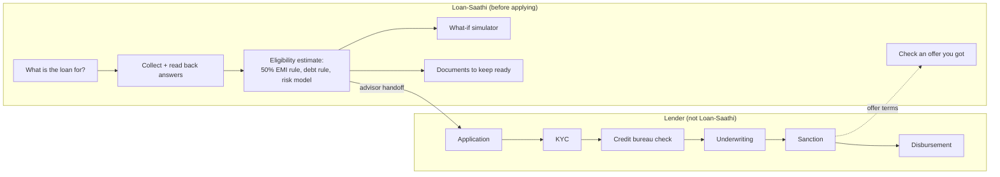
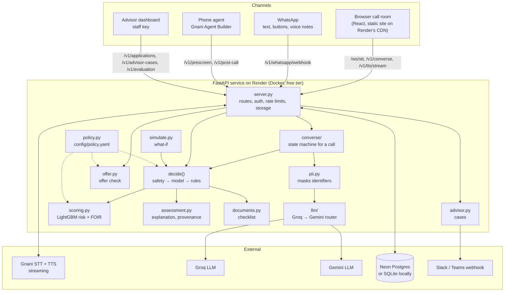
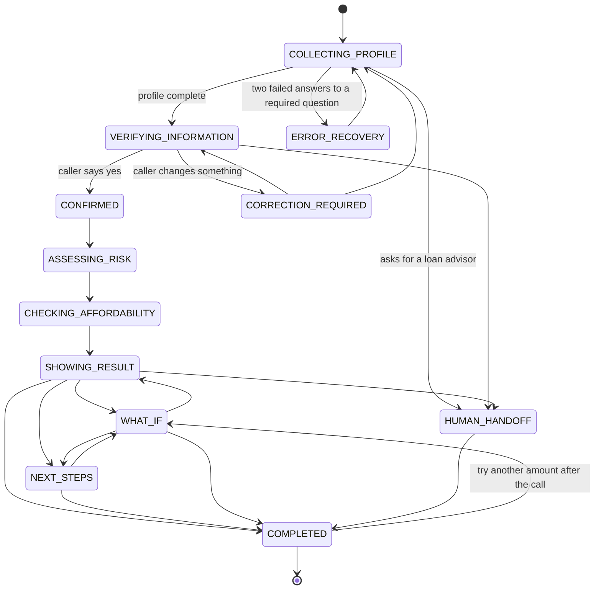
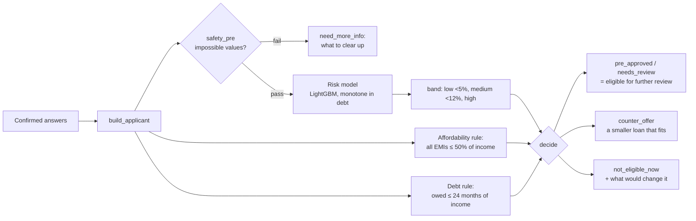
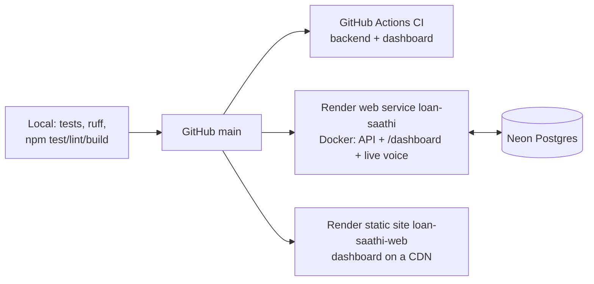

# Loan-Saathi: system design

Loan-Saathi is a voice-first loan pre-screening assistant for first-time borrowers in India. A caller talks
(Hinglish, English or Hindi) about the loan they want; Saathi collects and reads back their answers, estimates
whether the loan fits their income and how risky it looks, explains why, lets them try other amounts, checks an
offer they already have, and lists the documents to keep ready. It never approves a loan: the result is a
pre-screening estimate, and a loan advisor or lender decides.

Design decisions and the reasons behind them are in [`docs/decisions.md`](decisions.md); this page is the map.

## 1. Where it sits in the lending process



Saathi covers step 1 of a lender's flow (choosing the loan), a self-reported version of step 4 (credit
assessment), guidance for step 5 (documents) and a check on step 7 (the offer). It does no KYC, pulls no bureau
report, never collects identity documents and never decides.

## 2. Architecture



### Components

| Component | Responsibility |
|---|---|
| `src/server.py` | HTTP and WebSocket routes, the webhook key and per-call tokens, rate limits, storage (SQLite or Postgres through one portable `_run()`), retention purge, `build_applicant()` and `decide()` |
| `src/converse/` | The web call: a package of `settings`, `states` (allowed transitions), `fields` (questions, limits), `texts` (everything Saathi says, prompts), `validation` (checks, read-backs, next question), `parser` (our Hindi/English parser), `llm` (quote-gated extraction), `sessions`, `values` (contradictions, pending read-backs), `dialogue` (the turn) |
| `src/llm/` | Provider router: Groq first, then Gemini, one deadline, one retry on bad JSON, a response cache |
| `src/pii.py` | Masks phone, Aadhaar, PAN, IFSC, account and card numbers, email, date of birth, PIN code and names before any LLM sees text |
| `src/normalize.py` | Spoken values to inputs: "dhai lakh", "6 mahine", "kirana ki dukaan", "bike ke liye" |
| `src/scoring.py` | LightGBM risk (28 features), calibrated probability, risk band, what-if reasons, the FOIR affordability rule, EMI ranges |
| `src/assessment.py` | The borrower-facing assessment: figures with their source, why, completeness, the safety check |
| `src/simulate.py` | What-if: a copy of the applicant through `decide()` with another amount or tenure |
| `src/offer.py` | "Check an offer you got": real yearly rate (fees included), total cost, fits the 50% rule |
| `src/documents.py` | Documents to keep ready, from the loan purpose and how the caller earns |
| `src/policy.py` + `config/policy.yaml` | Every lending rule in one validated file |
| `src/advisor.py` | Advisor cases built from the call, with a summary posted to a webhook |
| `src/whatsapp.py` | The same conversation over WhatsApp (Meta Cloud API), voice notes through Gnani |
| `dashboard/` | React + Vite: the borrower call room (landing page, live mic, captions, simple result view, offer check) and the staff views (pre-screens, advisor cases, Evaluation Lab) |

## 3. One call turn

```mermaid
sequenceDiagram
    autonumber
    participant B as Browser (call room)
    participant S as API (server.py)
    participant G as Gnani STT/TTS
    participant C as converse
    participant L as LLM router
    B->>S: /ws/stt (16 kHz PCM, live mic)
    S->>G: stream audio (key stays on the server)
    G-->>S: transcript (end of speech by Gnani's VAD)
    S-->>B: transcript
    B->>S: POST /v1/converse {session_id, text} + call token
    S->>C: turn(session, text)
    C->>C: mask identifiers (pii.py)
    C->>L: extract answers (one LLM call per turn, 3 s deadline)
    L-->>C: answers, each with a quote of the caller's words
    C->>C: drop unquoted answers; our parser fills what the LLM missed
    C->>C: validate, read back risky values, ask about contradictions
    C-->>S: reply + state, answers, buttons
    S-->>B: reply (stored per turn)
    B->>S: POST /v1/tts/stream (reply)
    S->>G: streaming TTS
    G-->>B: audio from the first chunk (caller can interrupt)
```

If no LLM answers within the deadline, the parser carries the turn alone: the call never depends on an LLM.
Measured on a scripted 13-turn call (`reports/latency_benchmark.json`): caller stops → first audio of the reply,
median 2.17 s with Groq.

## 4. The call's state machine



`converse.TRANSITIONS` lists every allowed move; anything else raises `InvalidTransition`. Nothing is assessed
until the caller confirms the read-back (`require_confirmed()`). "Check an offer you got", a language switch and
a question ("EMI kya hota hai?", answered in the caller's language from `src/converse/faq.py`) are asides: they
never change the state or the answers, and Saathi goes back to what it was asking.

Question order (short call): what the loan is for, then the questions the rules read (amount, tenure, income,
other loans), then the questions only the model reads (work, years, repayment history, housing, age), each asked
only while some answer could still move the risk band. Turns to the result: mean 14.43 → 13.04 on 200 random
applicants, same decision for all 215 tested (`reports/call_length.json`).

## 5. How a decision is made



- The LLM never decides: `decide()` is the model plus fixed rules from `config/policy.yaml`.
- The loan amount offered comes from the 50% rule, not the model. EMIs are shown as a range across 14–24% a
  year; the rules use 18%.
- The model (`models/voice_model.txt`): LightGBM on the Home Credit dataset, 28 features a caller can answer,
  validation AUC 0.711 (`models/metrics.json`); no gender or marital status; risk can only rise with
  EMI-to-income and debt-to-income. Age is never given as a reason.
- The simulator and the advisor case go through the same `decide()`, so nothing bypasses a rule.

## 6. Data

| Table | What it holds | Notes |
|---|---|---|
| `sessions` | A web call's state, saved after every turn | Resumable for 2 hours after a restart |
| `prescreens` | Each decision with the answers that produced it | Purged after the retention period |
| `calls` | Post-call records from the phone agent | |
| `advisor_cases` | Cases for a loan advisor (open → in review → closed) | Built only from the call's own data |
| `decision_audit` | Append-only: each decision, its normalised inputs and the model and policy versions | Inputs left out when the caller refused storage |
| `latency_metrics` | Measured browser turn timings | Numbers only |
| `study_results` | User-study surveys and persona runs | Synthetic runs kept apart |
| `wa_threads` | WhatsApp conversations | Phone numbers stored hashed |

Storage is Neon Postgres in production (`DATABASE_URL`) and SQLite locally; SQL goes through one helper with
portable placeholders. A caller can say "save mat karo" (don't save); saved calls are purged after 30 days
(`retention.days`).

## 7. API

| Route | Who | Purpose |
|---|---|---|
| `GET /health` | anyone | Liveness; the landing page pings it to wake the free server |
| `POST /v1/converse` | caller (call token) or staff | One turn of the web call; an empty session starts a call |
| `WS /ws/stt` | caller or staff | Live microphone → Gnani streaming STT |
| `POST /v1/stt`, `POST /v1/tts`, `POST /v1/tts/stream` | caller or staff | Speech to text, text to speech |
| `POST /v1/offer-check` | caller or staff | Check an offer: real rate, total cost, fits income |
| `POST /v1/simulate` | caller (own result) or staff | What-if on a saved pre-screen |
| `POST /v1/prescreen`, `POST /v1/post-call` | phone agent (key) | Agent Builder's mid-call action and post-call trigger |
| `GET /v1/applications` | staff | Recent pre-screens and calls |
| `POST/GET /v1/advisor-cases` | caller (own call) / staff | Create an advisor case; list cases |
| `PATCH /v1/advisor-cases/{case_id}` | staff | Move a case: open → in review → closed (a name is required) |
| `POST /v1/advisor-digest` | staff | Daily summary of open cases to the webhook |
| `GET /v1/evaluation` | staff | Evaluation Lab evidence |
| `GET /v1/audit` | staff | Decision audit log |
| `POST /v1/admin/purge` | staff | Retention purge |
| `POST /v1/metrics/latency` | caller or staff | Browser turn timings |
| `GET/POST /v1/whatsapp/webhook` | Meta (signed) | WhatsApp verification and messages |
| `GET /v1/study/*` , `POST /v1/study/survey` | staff | User-study kit |

## 8. Security and privacy

- **Closed by default**: without `WEBHOOK_KEY` the server refuses to start and every `/v1` route returns 503.
  Staff routes need the key; a borrower's browser gets a per-call token that only opens its own call.
- **Rate limits per network**: 20 new calls a day, 300 in all, 40 turns a minute, 5 advisor cases an hour
  (`RATE` in `server.py`).
- **No identifiers reach an LLM**: masked in `converse.llm` for every provider and before our own parser; a quote
  containing a masked span is never stored.
- **Keys stay on the server**: Gnani, Groq and Gemini keys are environment secrets; the browser talks to Gnani
  only through the server.
- **WhatsApp** requests are checked against Meta's signature; phone numbers are stored hashed.
- **Consent and retention**: the caller can refuse storage at any time; saved calls are purged after 30 days.
- **Wording**: never "approved", never a lender's name (`tests/suites/test_safety.py` scans every user-facing file).

## 9. Reliability and performance

| Concern | How it is handled |
|---|---|
| LLM down, slow or rate-limited | Groq → second Groq model → Gemini → our parser, under one 3 s deadline; a hung provider costs 3.0 s, not 8.0 s (`reports/stall_benchmark.json`) |
| Free server asleep (cold start ~30–50 s) | Dashboard served from a static CDN site that loads at once and pings `/health` on load |
| Restart mid-call | Sessions saved after every turn and resumed for 2 hours |
| Speech-to-text failure | Clean 502, never a made-up transcript; typing always works |
| Assessment failure | Error recovery, never a made-up result |
| Misheard numbers | Read-backs for ranges, bare numbers, -ty words and large values; contradictions asked, never overwritten |

## 10. Deployment



`render.yaml` is a Blueprint: both services redeploy on every push to `main`. Secrets (`WEBHOOK_KEY`, Gnani,
Groq and Gemini keys, `DATABASE_URL`) are set in Render, never committed. See [`deploy/DEPLOY.md`](../deploy/DEPLOY.md).

## 11. Limits and next steps

- **One instance**: live sessions are kept in memory and saved per turn; a second instance would need sessions
  read from the database on every turn (the code already resumes from it) and shared rate-limit counters.
- **Free tiers**: the API sleeps when idle; Groq allows 8,000 tokens a minute per model; Gemini's free quota can
  run out. The call degrades to the parser rather than failing.
- **Self-reported data**: no bureau check or bank data; the estimate is only as good as what the caller says.
- **Not yet measured with real borrowers**: every figure above is scripted or synthetic.

## 12. Testing and evaluation

`python -m pytest` runs 35+ suites: unit tests in `tests/` and end-to-end scripts in `tests/suites/` (each starts
its own server). The dashboard has `npm test`, `lint`, `typecheck` and `build`. `src/evaluation.py run` records
every suite for the Evaluation Lab. Benchmarks: `src/bench_extraction.py` (dev 64/64, held-out 51/54),
`src/bench_latency.py`, `src/bench_stall.py`, `src/bench_call_length.py`.
